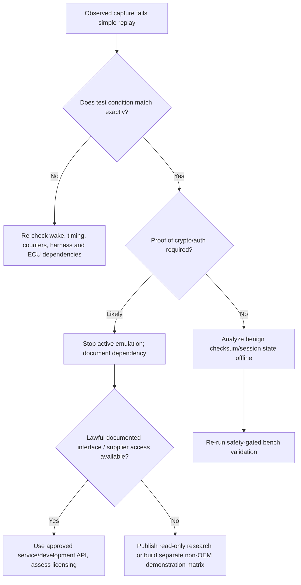

# 06 — Phased implementation: gates, estimates and exit tests

**Effort** is engineer time, excluding donor-car access, procurement and expert safety review. No phase is permission to perform live-road experiments.

| Phase | Effort (person-days) | Tasks | Exit gate |
|---|---:|---|---|
| **0 – Safe lab / identification** | 2–5 | Acquire *non-laser* documented assembly; inspect physical label and wiring; power budget; fuses, interlock, temperature monitoring; consent/provenance log. | Signed verification checklist; all external pins either verified or left unconnected. |
| **1 – Passive analysis** | 4–10 | Record K-CAN3 captures from authorized donor car / safe isolated harness; correlate on/off/DRL/turn/low/high/Selective Beam; record timing, label and voltage. | ≥3 repeat captures per function, tagged with state, golden checksums, no injected traffic. |
| **2 – Protocol decoding** | 8–20 | Identify candidate IDs, structure/counters, checksum hypotheses, stream periodicity; DBC/LDF schema; on **isolated bench only**, bounded replay after E-stop validation. | At least one *repeatable* target function with 3 cold restarts and zero new fault conditions; catalogue negative results and residual unknowns. |
| **3 – Optional board/firmware analysis** | 5–20 | Photograph PCB & markings, inspect passive continuity, identify MCU/driver/diagnostic pads. Static analysis only of legally obtained unprotected firmware. | Photographic component map; license/legal decision memo. Never require RDP/secure boot bypass as entry criteria. |
| **4 – Controller prototype** | 5–12 | STM32G474, CAN transceiver & power interlock board, abstract time scheduler, exact verified-message allowlist, opt-in armed state. | Host/HIL bench tests pass, validation gate before lamp ever powered. |
| **5 – Firmware** | 7–15 | Init/disarmed/baseline/armed/fault state machine; watchdog; timeout abort; LED-function profiles **only if observed**, optional UART internal driver layer only after IC ID. | Fault injection tests, zero output after timeout, no bus activity in disarmed state; documented versioned protocol model. |
| **6 – HIL/optical validation** | 5–12 | Compare golden traffic, camera rig inside opaque enclosure, optical repeatability, thermal soak; noise, supply sag and restart tests. | Thermal envelope, no uncontrolled output, photometric report marked **non-certification**. |
| **7 – Community release** | 2–5 | Document evidence grading, reproduce tests, scan for identifiers, publish allowable logs and contribution rules. | CI green, no protected data, issues linked to evidence and gating. |

**Base planning total:** 38–99 person-days, excluding failed hypotheses, donor availability and manufacturing. If authenticated traffic blocks Phase 2, the project becomes a documented feasibility result rather than a promise to bypass security.

## Protocol workflow

1. Produce a **state-change test matrix** (each switch state independently; timing synchronized). Start with listen-only instrumentation and no hardware modifications.
2. Catalog each frame with ID, DLC, period, byte-wise entropy, associated state, direction hypothesis and confidence (`protocol/frame_catalog.csv`).
3. Test one explanatory hypothesis per experiment. Track counter/checksum candidates **offline** before any electrical replay.
4. Compare edge conditions: 12 V variation, warm restart, cold start, presence/absence of other ECU chatter, DTCs and FLE sleep/wake.
5. Bounded isolated replay only when the data is authorized, exactly documented and reviewed. Do not brute-force unknown IDs or security functions.
6. If a transition works but LED segmentation does not, report **mode-level interoperability only**.

## Firmware interfaces and state machine

- HAL layer: `read_only_bus_receive()`, safe GPIO interlock state, supply/thermal health, monotonic timestamp, fault indicator. **No transmitter in this release's firmware**.
- Application: `SAFE_OFF` → `OBSERVING` → `ARMED_PENDING_PROOF` → `BENCH_READY` and any violation → `FAULT_LATCHED` → explicit manual reset.
- **Hard rule:** real lamp commands are **not implemented**, even if firmware switches to simulated ready state. Add an opt-in, reviewed, compile-time-delimited dedicated driver only after Phase 2.
- Matrix framebuffer: optional `uint16_t intensity[12]` in a higher-level simulator, **not evidence of actual lamp addressing**. FLE fault handling is read-only; never forge 'healthy' sensor feedback.
- Diagnostics: catalogue read-only supported services only if proven; do not emulate coding, authentication or ECU identities.

## Phase 2 branch: authenticated/encrypted link

No key extraction, replay of protected identity tokens, secure boot attack, immobilizer, BDC security or firmware readout-protection bypass is part of this plan.

## Measurable acceptance tests

- **Safety:** power cut when interlock opens; watchdog and thermal halt; no lamp control from unreviewed host input.
- **Repeatability:** 3 successful controlled cycles with no manual hidden steps; logs with monotonic timestamps and provenance.
- **Protocol:** clear separation between confirmed observed bits, likely transforms and unsupported hypotheses; DBC parses test logs.
- **Optics:** no unmanaged beam, light box closed, camera histogram and intensity mapping archived; not offered as regulatory compliance.
- **Publication:** sources ledger checked, no personal/protected artifacts, full offline-demo CI.
