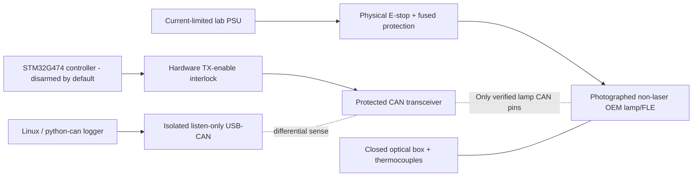

# Bench connection model — conceptual only

**This is not a wiring diagram.** Connection is prohibited until `pinout-template.csv` has filled verified pins for an exact physical part. A retrofit adapter's connector pinout must not be substituted for the OEM lamp's connector. See [architecture](../docs/01-architecture.md) and [safety](../docs/04-legal-safety.md).

Preflight: correct OEM mating connector, verified ground, verified supply with nameplate voltage/current budget, measured differential pair, fusing, active cooling, emergency cutoff, closed optical box, logger in listen-only mode, no laser labels. Do not bypass the lamp's FLE.
